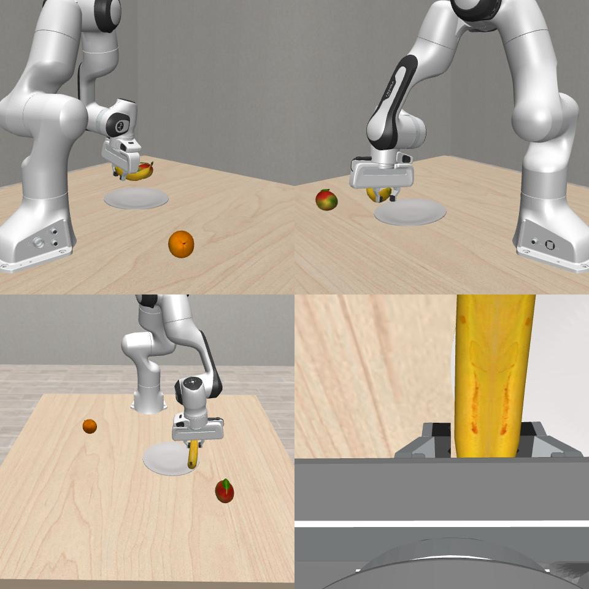

# Current status

2026-10-20: the full sweep has finished, with 2413 valid episodes, 47 physics errors and 558 successes across all 50 groups. Both cards were returned to the queued RLT jobs. See [complete results and coverage](results-20261020/RESULTS.md).

## Accepted startup record

2026-10-19 23:13 CST: the four-episode integration smoke passed and the full **50 groups / 2460 released scenes** evaluation started on Shenzhen 2 physical GPUs 4/5. Two simulator processes share each card's official policy server. The former workload was closed at its complete checkpoint before handoff; the original per-card RLT jobs remain next in queue.

| Smoke task | Native outcome | Executed actions | Video frames |
|---|---|---:|---:|
| select_fruit | success | 138 | 139 |
| add_condiment | success | 174 | 175 |
| select_drink | success | 123 | 124 |
| select_poker | policy failure; progress 1/3 | 100 | 101 |

Zero runtime errors. Each MP4 was checked for the recorded frame count and retains the four native cameras, including the terminal observation; the fruit terminal mosaic was visually inspected. The smoke completed in approximately 135 seconds including both model startups, imports, first compilation and cleanup. These four handpicked integration tasks are **not** a benchmark success-rate estimate.

The native model predicts 10 actions and replans after 5; no policy, IK or task-success logic was changed. Native task-specific horizons remain in effect, including poker's 100-action horizon. GPU guard checks ran during execution; the release receipt confirms no remaining owned contexts.

Lightweight raw logs, episode results, GPU scope and video metadata are in [smoke-light-evidence.tar.gz](smoke-light-evidence.tar.gz). Videos and checkpoints remain on the data volume. The full sweep preserves both valid successes and failures, records errors/missing scenes separately, and skips a task after three consecutive infrastructure exceptions or 15 minutes without progress. Full results are still running; no aggregate score is asserted.

Fruit smoke terminal observation, in native four-camera order:

