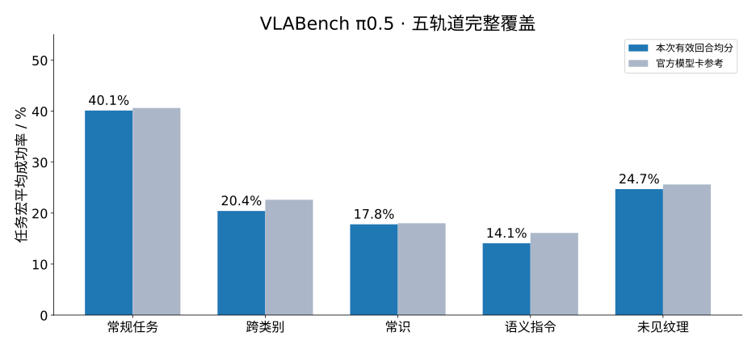

# Official π0.5 evaluation: completed 2026-10-20

All 50 released task/track groups were attempted. 2413 of 2460 configurations produced valid episode outcomes, including 558 successes; 47 ended in the same MuJoCo `mjWARN_BADQACC` physics-state error. Errors are retained separately, and no failed configuration was silently retried or replaced.

| Track | Valid / planned | Task macro success | Official reference |
|---|---:|---:|---:|
| In-distribution | 492/500 | 40.10% | 40.6% |
| Cross-category | 451/460 | 20.41% | 22.6% |
| Common-sense | 492/500 | 17.79% | 18.0% |
| Semantic instruction | 489/500 | 14.07% | 16.1% |
| Unseen texture | 489/500 | 24.69% | 25.6% |

The in-distribution mean (40.10%) is close to the official 40.6% reference. Generalization remains weaker, particularly semantic instructions (14.07%). This supports a functioning model/evaluator integration, not a claim of bitwise or statistically established replication. The reference uses unpaired runs, and the released cross-category flower JSON contains only 10 configurations.

Success rates above first divide each task’s successes by its valid outcomes, then average the ten tasks. Coverage is always shown. Across all configurations, 558/2413 = 23.12% of valid episodes succeeded; 558/2460 = 22.68% if every error is conservatively counted as unsuccessful. The physics exception alone does not establish whether a particular scene, action or simulator instability caused it.

[Official model card and reference table](https://huggingface.co/VLABench/pi05-primitive-10task#reference-results), retrieved 2026-10-20.

Runtime was approximately 8.55 hours including startup and teardown. The finite sweep ended around 07:46 CST and cleared its owned GPU contexts. The existing resource owner then resumed the original two per-card RLT jobs; both were observed advancing at 10:40. No unrelated job was restarted.

2413 complete four-camera MP4s (~2.36 GiB) and terminal mosaics remain on the server. This repository stores the compact raw logs/episode results, errors, summaries and release evidence in `full-light-evidence.tar.gz`; it contains no model weights or videos. Protocol, paired revisions and smoke checks remain in the parent folder.
